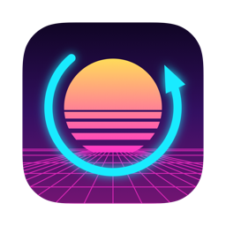
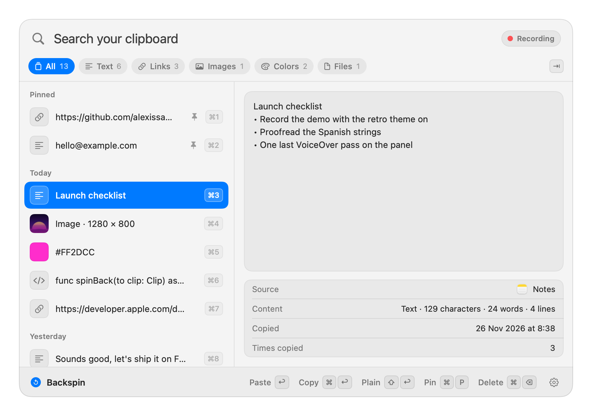
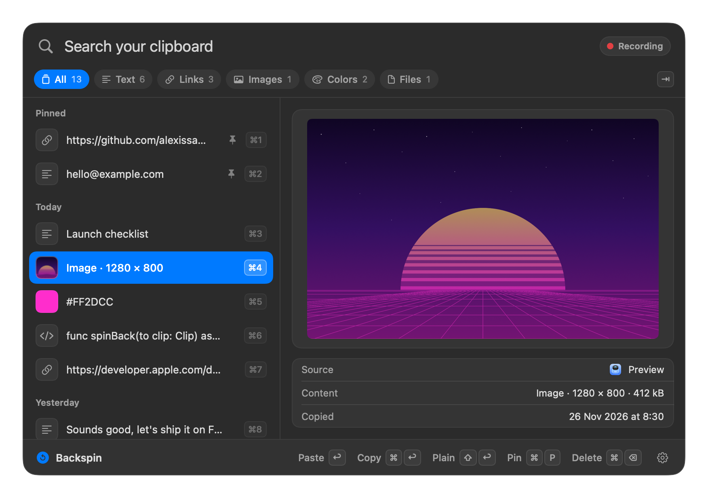
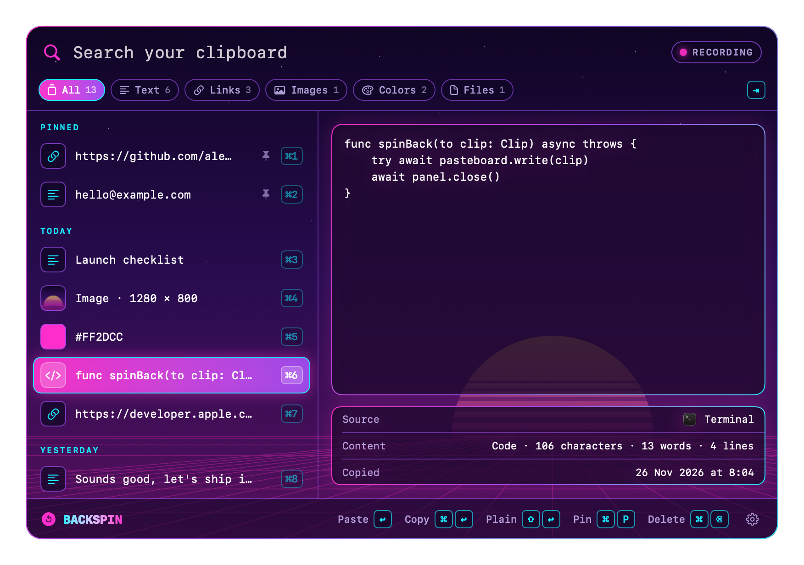
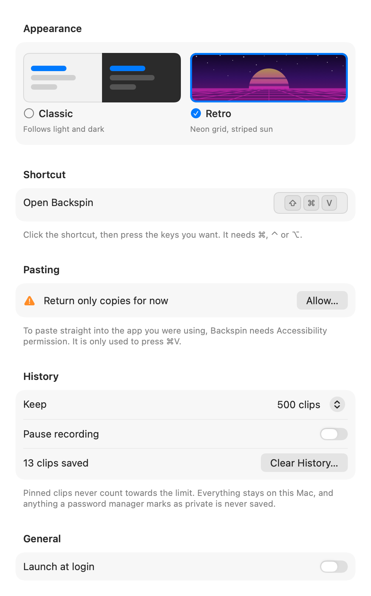

<p align="center">
  
</p>

# Backspin

**Everything you copied, one shortcut away.** Backspin is a macOS menu bar clipboard history. Press a shortcut, find what you copied earlier, and paste it straight into the app you were using.

The name is a DJ's backspin: spin back through what you copied.

<p align="center">
  
  
</p>

<p align="center">
  
</p>

<p align="center"><sub>Screenshots use made-up demo clips.</sub></p>

## Highlights

- **One shortcut.** `⇧⌘V` opens a floating panel on the screen your pointer is on. It doesn't activate Backspin, so Return pastes straight into the app you were using.
- **More than text.** It keeps text (with its rich-text formatting), links, colours, images and files copied in Finder.
- **Search and filter.** Type to search, or press Tab to jump between kinds. Counts sit on every filter.
- **Keyboard first.** Paste, copy, paste as plain text, pin and delete without touching the mouse.
- **Two looks.** Classic follows your Mac's light or dark appearance. Retro is full synthwave, shared with its sibling [NextUp](https://github.com/alexissan/NextUp).
- **Private by design.** No network code, no accounts, no analytics. Clips that password managers mark as private are never saved.

## Quick start

You need macOS 15 or later and the Xcode command line tools (Swift 6).

```sh
git clone https://github.com/alexissan/Backspin.git
cd Backspin
./build.sh
```

`build.sh` builds a release binary, wraps it in `Backspin.app`, signs it ad hoc, installs it in `/Applications` (quitting and replacing any earlier copy), and launches it. Pass `--no-install` to only build the bundle next to the script.

Backspin lives in the menu bar and has no Dock icon. Copy something, then press `⇧⌘V`.

Pasting needs Accessibility permission, which Backspin uses only to press ⌘V for you. Without it, Return copies the clip and you paste it yourself. Allow it from the panel footer or from **Settings**.

Want a look first? Demo mode shows made-up clips and neither reads nor saves your real clipboard history. Quit Backspin if it is running, then:

```sh
open -a Backspin --args --demo
```

## How it works

### What it captures

| You copy | Backspin keeps |
|---|---|
| Text | The text and, when there is any, its rich-text formatting. `⇧↩` pastes it as plain text |
| A link | The link, with an **Open Link** button |
| A colour (hex, `rgb()`, `hsl()`) | A swatch, with HEX, RGB and HSL values side by side |
| An image | The image, with its pixel size |
| Files in Finder | The file list, with icons |

Copying the same thing again doesn't add a duplicate. The existing clip moves to the top and its **Times copied** count goes up.

The detail pane shows a preview and what is known about the clip: the app it came from, its content (characters, words and lines for text), when it was copied and how many times.

### The panel

- **Search as you type.** Every word must match, and the name of the source app counts too.
- **Filter chips** for All, Text, Links, Images, Colors and Files, each with a count. `⇥` and `⇧⇥` cycle through them.
- **Sections:** Pinned, Today, Yesterday, This Week, This Month and Older.
- **Recording light** next to the search field. Click it to pause or resume saving what you copy. The menu bar item has the same switch.

### Keyboard

| Key | Action |
|---|---|
| `↑` `↓`, `⌃N` `⌃P`, Page Up, Page Down | Move the selection |
| `↩` | Paste the selected clip |
| `⌘↩` | Copy only, don't paste |
| `⇧↩` | Paste as plain text |
| `⌘1` to `⌘9` | Paste that row |
| `⌘P` | Pin or unpin |
| `⌘⌫` | Delete |
| `⇥` `⇧⇥` | Next or previous kind |
| `⎋` | Clear the search, then close |
| `⌘,` | Settings |

Double-click a row to paste it, or right-click for the same actions.

### Settings

Open them from the gear in the panel, the menu bar item, or `⌘,`.

| Setting | What it does |
|---|---|
| Appearance | Classic or Retro |
| Shortcut | Record a new global shortcut. It needs ⌘, ⌃ or ⌥. Reset returns to `⇧⌘V` |
| Pasting | Shows whether Accessibility permission is granted, with a button to allow it |
| Keep | How many clips to remember: 100, 250, 500 (default), 1000 or 2500. Pinned clips never count |
| Pause recording | Stop saving what you copy |
| Clear History | Removes everything except pinned clips, after a confirmation |
| Launch at login | Start Backspin when you log in |

<p align="center">
  
</p>

### Modes

| | Classic | Retro |
|---|---|---|
| Appearance | follows the system, light or dark | always dark |
| Backdrop | system material | night-purple sky, striped sun on a neon grid |
| Type | system font | monospaced, uppercase headers |
| Accents | system accent colour | magenta, violet and cyan |

Retro dims its backdrop when **Increase Contrast** is turned on.

### Accessibility

Everything in the panel works from the keyboard. Each row reads as one VoiceOver element, with its kind, title, source app, time and pinned state, and offers custom actions to paste, copy, pin or unpin, and delete. Filters report their counts and selection, and section headers are marked as headings. The colour swatch is described by its hex value. **Reduce Motion** removes the panel fade and stops the recording light pulsing. Backspin is available in English and Spanish.

## Privacy

Backspin has no network code, no accounts and no analytics. Your history lives in `~/Library/Application Support/Backspin`: an `index.json`, plus a `blobs` folder for images and rich text. Clips that a password manager marks as concealed or transient (the [nspasteboard.org](http://nspasteboard.org) convention) are never saved. Deleting a clip, or clearing the history, deletes its files too.

## Troubleshooting

**Return only copies.** Backspin needs Accessibility permission to paste. Turn it on under **System Settings → Privacy & Security → Accessibility**, or use **Allow…** in Settings.

**macOS asks for Accessibility permission again after a rebuild.** The app is ad-hoc signed, so every build has a new signature. Allow it again. If the prompt never comes back, reset the permission and relaunch:

```sh
tccutil reset Accessibility dev.alexissantos.backspin
```

**The shortcut does nothing.** Another app may already own it. Record a different one in **Settings**.

## Uninstall

Quit Backspin from its menu bar item, turn off **Launch at login** if you enabled it, then delete `/Applications/Backspin.app`. To remove your history as well, delete `~/Library/Application Support/Backspin`.

## Development

```sh
swift test
swift build && .build/debug/Backspin --screenshots docs
```

`swift test` runs 44 tests, written with Swift Testing, over the pure logic in `BackspinCore`. The second command regenerates the images in `docs/` from demo data, without touching your clipboard history. `./make-icon.sh` redraws the app icon. To try things without touching your real history, run the debug binary with `--store <folder>`.

| Path | What's there |
|---|---|
| `Sources/BackspinCore` | Models, content classifier, colour parsing, history rules and sections. No AppKit |
| `Sources/BackspinKit` | The pasteboard monitor and store, global hotkey, paste, launch at login |
| `Sources/Backspin` | The SwiftUI interface: panel, detail view, settings, themes, demo data |
| `Resources` | `Info.plist`, the app icon, and the English and Spanish strings |
| `build.sh` | Builds, signs and installs the app |
| `make-icon.sh` | Redraws the app icon |

## Known limits

- No prebuilt download yet: the app is ad-hoc signed, so you build it yourself.
- Text over 2 MB and images over 25 MB are skipped.

## Licence

MIT. See [LICENSE](LICENSE).
